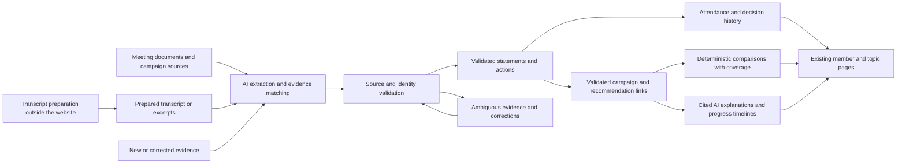

# Year-round council member profiles: automated accountability

Date: November 7, 2026

Status: Product direction agreed; detailed implementation remains a proposal.
Extend the existing member pages into year-round records updated automatically
as evidence arrives. AI and deterministic jobs perform routine enrichment;
manual work supplies difficult sources, corrects errors, and resolves ambiguity.
The next election cohort is the initial rollout. Conduct coverage is limited to
formal complaints and findings. Transcript preparation and speaker labeling
happen separately, outside the website. The main expected manual inputs are
locating the HTR candidate-profile article and preparing voter-forum transcripts.
The page sections, source responsibilities, update triggers, and proposed
operating cadence below flesh out that direction. They are design proposals,
not shipped behavior. Publication rules and cost limits need pilot evidence
before broad rollout. GitHub tracking links below organize implementation;
this document does not claim the feature is implemented or deployed.

## Delivery priority and proportionality

Owner decision, November 8, 2026: TwoRiversReporter is an independent city
watchdog, not the official city record or a legal records system. Ordinary site
errors can be corrected when discovered or reported. Engineer for useful,
sourced reporting and practical correction, without treating every possible
mistake as a severe or irreversible outcome. This decision governs the scope
and sequencing of the more detailed proposals below.

- Preserve the existing implementation PRs. Keep stable source/decision links,
  basic extraction validation, reuse of unchanged work, and explicit spending
  and retry limits. No paid generation is enabled by this adjustment.
- Treat published minutes and accepted votes as stable during ordinary operation.
  Meeting/topic prose reanalysis reuses established votes and attendance. Changed
  source content or an explicit factual correction can trigger fact extraction;
  a narrative prompt/model change alone cannot. This is an operating assumption,
  not a claim that city records never change or our extraction is always right.
- Make the next slice a readable member record under #237/#240: recorded votes,
  meeting/source navigation, and honest coverage, followed by evidenced service
  periods and campaign enrichment. Show missing campaign material as a gap;
  do not delay the first useful page for it or imply a complete term denominator.
- The default Featured votes view must paginate as well as All recorded votes.
  Keep procedural decisions when the recorded vote is not unanimous approval;
  omit routine procedural motions only when passed with every recorded attendee
  voting yes. Exclude absences from that test; abstentions and recusals are not
  affirmative votes. Apply the rule even when a procedural motion is associated
  with an important topic. This uses recorded votes, not an inferred complete
  attendance denominator. Keep the unfiltered view available for inspection.
- A correction is entered once, retained, and reflected in the affected record
  and implemented profile views. Reuse existing refresh paths for known
  dependents. Defer further generalized withdrawal cascades, speculative race
  handling, and rare correction variants until a concrete problem warrants a
  bounded fix; they are not prerequisites for the first readable record.
- Judge progress by the reader's source-to-page workflow. A synthetic failure
  demonstrates a conditional defect, not its frequency in production. Identify
  whether a problem is observed, introduced by new code, or hypothetical before
  investing in more defenses. Apply representative behavioral checks to the
  slice being delivered; do not expand into an exhaustive fault matrix.

Source attribution, no fabricated votes or conclusions, access/privacy rules,
and enforced spending limits remain requirements. Formal complaints and findings
still need careful attribution. Proportionality changes delivery priorities;
it does not turn unsupported claims into acceptable reporting.

## Purpose and first release

A resident should be able to answer: What did this person say they would do?
What did they actually do in office? What happened to those issues? How does
their record compare with the other people voting on the same decisions?

The permanent product surface is each existing `/members/:id` page. Build on
its attendance and voting record so residents can track a member's priorities,
actions, and results throughout service. Use one reusable page and enrichment
pipeline for all members; no bespoke profile writing or periodic hand-publishing
is required to keep the feature current.

Start the rollout with the council members whose terms are next due for election.
That choice scopes historical validation and initial coverage, not a separate
seasonal product or content workflow. Do not assume they intend to run again.
An election comparison view can later reuse the same records and include
challengers' sourced positions; it is optional future presentation work, not
the foundation of this feature. Having no council record is not a negative result.

The city describes a nine-member, at-large council, with three members elected
each April to three-year terms ([official council page](https://www.two-rivers.org/citycouncil)).
For the next regular cohort in 2027, April 2024 is the proposed shared historical
starting point. The [April 16, 2024 organizational minutes, included in the May 6 packet, PDF page 5](https://mccmeetings.blob.core.usgovcloudapi.net/tworivrswi-pubu/MEET-Packet-0a3667b40f544f5faa60d89c5fc48508.pdf#page=5)
record Doug Brandt, Shannon Derby, and Mark Bittner's swearing-in. Confirm any
intervening vacancies or term changes against election/office records during
discovery. Import the full April source window, but apply each person's actual
service dates when counting attendance and decisions.

Backfill the shared Council meeting history from that April forward, capturing
all participants, not just the initial rollout cohort. Later cohorts can
reuse those meetings, votes, recommendations, and topic histories. Their campaign
sources and individual service windows still need separate collection. Earlier
terms and earlier topic context can be linked explicitly without silently
expanding a current-term comparison.

The first cohort is the initial rollout scope, not the limit of the data model.
Use a small sample of campaign and meeting sources to test the reusable pipeline.
Any manually checked examples are evaluation references, not one-off pages to
maintain. Prove that a later meeting changes the generated profile automatically
and that a correction propagates without rewriting the page.

## Automation and manual inputs

Routine operation should be: sources arrive → AI extracts and relates evidence →
validation checks source references and identities → deterministic jobs update
counts and comparisons → the affected member profiles refresh automatically.
AI-generated explanations retain citations and distinguish actions from outcomes.

| Input or change | Automated work | Human involvement |
| --- | --- | --- |
| New or revised meeting documents | Extract attendance, decisions, attributed actions, and explicit recommendations; link members/topics; update affected profiles and comparisons | Resolve ambiguous or conflicting evidence and correct errors |
| HTR or another candidate questionnaire | From one supplied source, extract each identified candidate's positions, preserve context/citations, and link topics and election/term | Locate/provide the article URL or permitted source material when discovery cannot find it |
| Voter forum | Ingest a prepared speaker-labeled transcript or excerpts; extract positions and evidence links for all identified participants | Prepare/correct speaker attribution in a separate workflow and supply the result with recording references |
| New topic developments | Relate new actions and outcome evidence to relevant campaign positions; refresh affected timelines and generated explanations | Resolve uncertain matches or interpretations |
| Source, identity, or term correction | Retain the correction, update the affected record/profile, and refresh known dependents through existing paths | Supply the correction once, with its basis |

Manual onboarding is normally per source, not per candidate, statement, or page.
No routine requirement to enter every promise, connect every vote, approve every
routine extraction, or rewrite a profile after each meeting. Missing campaign
material does not block the existing attendance/vote record or other automated
enrichment; show the coverage gap and enrich it when the source becomes available.

Use AI for extraction, matching, and narrative explanation. Use deterministic
code for arithmetic, eligibility, deduplication, source/identity validation,
version checks, and refresh orchestration. Automated acceptance requires defined,
tested evidence checks; a model's confidence number alone is not a publication
rule. Unresolved identities, conflicting sources, unsupported comparisons, or
unclear formal-case status become targeted exceptions. Valid unrelated evidence
continues through the pipeline.

Each job is incremental and idempotent. New evidence refreshes only dependent
members/topics, with coalesced work, change detection, retry limits, and observable
failures. Source versions and dependency tracking prevent stale output and
unnecessary AI regeneration. The proposed triggers, reconciliation cadence, and
spending controls are specified under Automatic updates below. Measure unattended completion,
accuracy, correction propagation, and exception workload in the pilot; automation
that merely moves all the work into an approval queue does not satisfy the goal.

## Product questions and evidence

| Resident question | Proposed feature | What supports the answer |
| --- | --- | --- |
| What did they campaign on? | Dated campaign positions and specific commitments, grouped by topic and election | Candidate-authored material, attributed questionnaire responses, and reviewed recording excerpts |
| Did they show up? | Council attendance during the selected service period, with counts and missing-record coverage | Meeting roll calls, held/cancelled status, service dates, and recorded arrivals/departures |
| How did they vote? | Complete decision history with the motion, each member's vote, outcome, and sources | Validated minutes-based motions and individual votes |
| Did they push for something? | Documented proposals, amendments, requests, questions, objections, and follow-up | Attributed minutes or reviewed recording segments, including attempts that never reached a vote |
| Who did they agree with? | Pairwise comparisons and a separate view of divided votes | The same eligible decisions, named votes, explicit denominators, and exclusions |
| Did they support the manager or staff recommendation? | Decision-level recommendation comparisons | A recommendation recorded before the vote, its author/role, exact proposal, and the motion actually voted on |
| What did they do on an important public issue? | Topic timeline and council vote table | Decisions linked to a persistent civic topic, with why that topic was selected |
| Did they follow through? | Campaign statement alongside actions, position changes, and project/policy outcomes | Source-backed links between the original statement and subsequent evidence, validated automatically or resolved through exception review |
| Were there formal conduct proceedings? | Complaint and disposition timeline | Formal complaint records, notices, findings, decisions, and any subsequent correction or appeal |

Do not create an overall performance grade, integrity score, or automatic
endorsement. Agreement, dissent, speaking time, and moving a motion are facts
or measurements; none independently establishes effort, independence, competence,
or motive. A well-supported account can still show sustained advocacy or a
documented reversal, with the underlying actions available to the reader.

## Existing foundations and gaps

Repository observations refreshed at `5d9ff761ebac452a51278d9c2841b9111261b6ad` are static
code evidence, not an audit of production completeness or extraction accuracy.

| Foundation | Reuse | Gap to resolve |
| --- | --- | --- |
| `Member`, aliases, committee memberships, `MemberPosition` | Stable public-person identity and existing profile URLs | An elected term is not the same as a current office/title; preserve elections, repeat terms, appointments, and historical eligibility |
| `MeetingAttendance` | Present/absent/excused and voting-member classification | Existing rows do not establish the universe of expected meetings or partial attendance |
| `Motion` and `Vote` | Decisions, member votes, agenda/topic links | Review state, source-version/location provenance, motion sequence/amendments, proposers, and explicit versus derived values |
| `ResidentContent::OfficialProfile` | Existing profile, topic navigation, attendance display | Current attendance uses stored rows; selected topic groups and procedural filters are presentation rules, not an analytics denominator |
| Meeting discovery, documents, and citations | Existing nightly discovery with a 90-day lookback, conditional downloads, content hashes, extraction, source resolution | Durable source versions, older coverage checks, campaign material, and assertions outside an official meeting |
| Canonical roster services | Official Council/manager identity and current-role reconciliation | Currently invoked through roster tasks; add scheduled source checks and separately evidenced service terms |
| Existing meeting transcript import | Existing meeting-reporting context and recording references | Campaign/forum preparation happens separately; the feature accepts prepared transcripts or excerpts with provenance, without an in-app transcript editor |
| `Entity`, `EntityFact`, `StanceObservation` | Existing groundwork and related issue #59 | Not a complete campaign pipeline; stance observations currently require a meeting and meeting document, with a free-text topic |
| Knowledge sources | Background and proposed/approved/blocked review patterns | Free-form background alone cannot supply reproducible campaign-to-action comparisons |

Two boundaries need design before building associations:

- [ExtractVotesJob](../../../app/jobs/extract_votes_job.rb) destroys and recreates
  motions during extraction. Approved evidence links must not hang only from
  replaceable motion IDs. It also maps unsupported vote values to abstention and
  derives absent votes from attendance. New comparisons must distinguish explicit,
  derived, unknown, and invalid observations instead of silently accepting those
  transformations as verified facts.
- [OfficialProfile](../../../app/services/resident_content/official_profile.rb)
  is a display projection. Its topic selection, five-group cap, and procedural
  filtering must not become the source of a purportedly complete record or a
  comparison denominator. Multi-topic motions must count once per decision.

The [April member-page design](2026-04-12-committees-and-members-redesign-design.md)
explicitly deferred voting analytics and excluded computed judgment statistics.
This proposal introduces explainable descriptive comparisons and campaign
tracking. Approving those requires reconciling that spec and the
[Development Plan](../../DEVELOPMENT_PLAN.md), not treating current code or this
draft as approval. Preserve [Topic Governance](../../topics/TOPIC_GOVERNANCE.md)'s
distinction between factual record, institutional framing, and interpretation.
Issue #59's older description is not a substitute for the current governance.

## Evidence validation and correction contract

Every published assertion needs a source and a place within it: document/page,
article passage, or recording interval. Record source URL, publisher, source
type, event date, publication date when known, retrieval date, and source version
or content hash. A publication date is not an event date. Posted minutes are not
called approved minutes without approval evidence.

Distinguish collected/extracted evidence, automatically validated evidence,
human-confirmed exceptions, unresolved/rejected evidence, and superseded versions.
Record the validation method and rule version; automatic processing must not
claim a human reviewed it. AI extracts identities, classifications, links, and
summaries; source and identity checks govern routine acceptance. Uncertain speaker
attribution or an unsupported campaign comparison cannot become a fact solely
because the model assigned itself a high confidence score.

Original evidence and generated interpretation remain separate. Corrections keep
before/after history, actor, date, and reason. Reprocessing must preserve explicit
corrections or flag a conflict for resolution. Changed source content must pass
validation again and cannot silently inherit an old approval. A removed source is identified
as unavailable; it is not replaced with a different document at the same URL.
Use retained artifacts where permitted, and distinguish source availability
from what was verified earlier.

For article sources, retain source metadata, allowed supporting excerpts, and
original links. Do not design a public full-article mirror or bypass restricted
access. Separate candidate quotations from a reporter's paraphrase. Auto-captions
are transcription aids: verify the audio before publishing a direct quotation.

All official profiles use the same rules. The public explanation should disclose
the coverage period, missing sources, selection method, update date, and a
correction contact. Validation and review remain auditable without exposing internal
notes, source credentials, or unnecessary complainant/contact details.

## Campaign collection and forum attribution

Capture each statement against its election and source, preserving the question
or surrounding context. Distinguish a concrete commitment, general priority,
policy position, and retrospective claim. A broad wish for lower taxes cannot
be rewritten into a promise to oppose every budget or borrowing motion.

Keep conditions, timeframes, and the person's proposed action. Repeated mentions
across sources can support one commitment; retain their provenance rather than
counting them as separate promises. Preserve later qualifications and position
changes as dated entries instead of overwriting what was originally said.

Owner decision: transcript preparation, speaker identification, and annotation
happen outside the website. Choosing or building a separate tool is separate
work; this feature does not require a new transcript editor or labeling UI.

The website accepts a prepared speaker-labeled transcript or a set of reviewed
excerpts as a source handoff. AI extracts the individual campaign statements;
the operator does not have to enter them one by one. Retain:

- Event title/date, recording URL, and source/transcript version.
- Reviewed speaker identity, supporting excerpt, start/end timestamps, and enough
  question/context to interpret the answer.
- Whether the text is a verified quotation or an attributed paraphrase, who
  reviewed it and when, and any remaining uncertainty or coverage limitation.
- A stable reference/version so a corrected excerpt or attribution can replace
  the earlier evidence and invalidate dependent statements and comparisons.

The handoff can cover the full forum or selected answers, with coverage stated.
Full prepared transcripts support extracting all relevant statements in one pass;
partial evidence does not imply the rest of the forum was analyzed.
Unknown speakers remain unresolved and cannot support a named campaign claim.
Automated statement extraction, topic matching, validation, and publication remain
app responsibilities, with ambiguous cases sent for exception review;
transcription and speaker-labeling mechanics remain in the separate workflow.
Forum material must not be treated as an official Council meeting or sent
automatically through the existing meeting import/summarization pipeline.

Initial source discovery found a [March 2025 League forum listing](https://my.lwv.org/wisconsin/manitowoc-county/event/two-rivers-city-council-candidates-forum)
and [Seehafer's April 2026 candidate questionnaire](https://www.seehafernews.com/2026/04/01/two-rivers-city-council-candidate-responses/).
These demonstrate source types to inventory; they do not establish 2024 campaign
coverage, recording availability, or usable speaker attribution. HTR, candidate
sites/materials, forum organizers, and other contemporaneous interviews remain
collection paths. Campaign evidence may predate the April meeting backfill.

November 8 update: the owner located the relevant 2024 HTR questionnaire, and its
dated archive was readable. The [pilot source inventory](https://github.com/AndreRobitaille/TwoRiversReporter/blob/codex/council-evidence-foundation/docs/superpowers/plans/2026-11-07-council-evidence-pilot.md#november-8-source-discovery-2024-htr-questionnaire)
records the original/archive links, attribution, inspected passages, and remaining
limits. The initial cohort now has a located campaign source; automated intake
and campaign-to-action verification remain implementation work.

## Attendance, decisions, and comparisons

### Attendance

Scope the default to City Council during the selected term. Include regular,
special, organizational, and work-session meetings where the member was eligible
to attend; distinguish meeting types. Show committee service separately.

Reconcile expected held meetings against the source inventory and service dates.
Cancelled meetings and time before/after service are excluded. Missing minutes,
missing roll calls, and unresolved attendance are unknown, never automatic
absence or presence. Preserve excused absence, remote participation, late arrival,
and early departure where documented. Presence at roll call does not establish
presence for every later motion.

Show present/absent/excused/unknown counts and source coverage. If a percentage
is used, label it as presence among meetings with known attendance and show both
the numerator and denominator plus unknown count. For example, synthetic data
with 8 present, 1 absent, 1 excused, and 2 unknown yields 8/10 known meetings,
with 2 unresolved; it is neither 8/12 confirmed attendance nor perfect coverage.
Peer comparisons must use comparable service periods and meeting types.

### Decision record

Preserve the exact motion, agenda context, sequence, amendments, withdrawal or
failure to receive a second, individual votes, outcome, and citations. A vote to
table, amend, enter closed session, hire, approve a contract, or accept a
resignation is a different action. A later personnel outcome does not change
what a member voted on earlier.

Keep yes, no, abstain, recused, absent, not eligible, and unknown distinguishable.
An aggregate tally or voice-vote result cannot manufacture named votes. If the
source explicitly identifies everyone participating in a unanimous vote, retain
that derivation and evidence rather than presenting an inferred roll call as
explicit. Initial comparisons use validated, individually attributable votes.

Represent a consent agenda's shared decision and item membership without
multiplying one vote into many independent observations. Record dissenting
items removed from consent separately. Deduplicate repeated imports, document
versions, meeting aliases, and multiple topic links.

### Agreement with other members

For members A and B, pairwise agreement is the number of eligible decisions
where both cast the same yes/no vote divided by the number where both cast a
known yes/no vote. Scope to a common service period and decision set. Exclude
unknown, absent, abstain, recused, and ineligible votes from that denominator and
show the exclusions. A zero denominator is unavailable, not zero percent.

Provide both all eligible substantive decisions and the subset with at least
one yes and one no. Unanimous votes can dominate the former. For the first
comparison release, show fractions such as “14 of 19 comparable votes,” alongside
coverage and the underlying decisions. Do not publish a
leaderboard or headline percentage. Any later percentage display needs a minimum
sample/coverage rule evaluated in the pilot; counts remain available regardless.

Majority/minority descriptions use known yes/no votes only. Ties have no majority;
abstention and absence are not dissent. Keep the official outcome separate from
arithmetic majority because passage rules and vote thresholds can differ.

### Agreement with staff or the city manager

Store each explicit recommendation with author, role at that time, date, source,
proposed action, conditions, and version. Keep the city manager, department staff,
and an advisory committee distinct. Being the presenter or packet author is not
proof of recommending approval. Multiple staff recommendations may conflict.

Validate whether a recommendation applies to the actual motion. A materially
amended proposal, an alternative, a procedural motion, or unclear timing can make
comparison unavailable. AI can propose the recommendation-to-motion mapping;
validate its sources, identity, timing, and motion relationship automatically,
and send unresolved cases for review. Compare only when yes/no can be mapped to
supporting or opposing the stated recommendation. If staff recommends rejection, a yes vote
on a motion to reject may agree with staff; matching words or vote direction is
not enough. Missing recommendations are unknown, not disagreement.

Report supported/opposed/unresolved counts for each identified recommendation
source. Any rate uses only validated comparable decisions with eligible yes/no
votes and retains the missing-coverage count. Reuse the all-substantive/divided
views without combining staff and manager into a fictitious shared position.

## Important issues, advocacy, and follow-through

Use existing persistent Topics, with an explicit and reviewable inclusion reason
for an automatically featured issue: resident impact, documented recurring concern, a material
decision, or a campaign commitment. Dissent can draw attention but does not prove
public importance. Keep the full decision record accessible so the featured
selection cannot stand in for everything the member did.

Use the concession-stand history and city-manager hiring decision as pilot
research questions. Confirm the relevant topic, motions, amendments, dates,
participants, and sources before writing conclusions. Capture distinct stages
such as approval, funding, contract, and completion. Neither one yes vote nor
a later resignation explains a person's motive or the project's full history.

Document advocacy as specific acts: introduced a proposal, sought an amendment,
requested analysis, asked for an agenda item, opposed an option, or returned to
the issue later. A proposal that did not receive a second can still be evidence
of effort. Seconds and speaking frequency do not automatically prove support or
effectiveness. Absence from an incomplete transcript does not prove inaction.

For each campaign statement, show three independent tracks:

| Track | Example states |
| --- | --- |
| Member's documented action | No relevant action found in the stated coverage; advocated; proposed; voted; changed position |
| Relationship to campaign statement | Consistent; in tension; mixed; not comparable; insufficient evidence, with a cited explanation and validation status |
| Issue outcome | Proposed; authorized; funded; underway; completed; rejected; deferred; unresolved/unknown |

The member may advocate and lose, vote for a project that never happens, oppose
something that succeeds, or inherit a decision made before their term. Keep
those distinctions visible. A position change may have a documented explanation;
preserve it. Do not infer that a completed project was caused by one member.
Do not compute a promises-kept percentage from vague priorities or missing
opportunities to act. Record whether a relevant decision opportunity occurred
and whether the member was serving and eligible at that time.

## Formal conduct proceedings

Owner decision: include formal complaints and findings, not an independent
editorial code-of-conduct grading system. A policy-adoption discussion or a
resident criticizing an official is not automatically a formal complaint.

For a documented case, retain the complaint date, alleged conduct as an
allegation, applicable policy version, receiving/reviewing body, procedural
steps, response, disposition, findings actually made, sanctions if any, and
appeal or later correction. Distinguish filed, pending, dismissed/withdrawn,
finding issued, and review/appeal states using the actual record's terminology.
An unresolved complaint is not a finding; dismissal is not automatically a
finding that every allegation was false. Report absence of records as a coverage
limitation rather than certifying that no complaints exist.

Case discovery must verify the underlying complaint and disposition records.
Public issue text and the eventual profile must rely on validated sources, not
turn a research lead into a factual allegation. Collect public records without
republishing unnecessary private complainant details.

## Proposed data boundaries

Keep the accountability feature in the existing Rails app with server-rendered
pages. Transcript preparation and speaker labeling are external to the app.
These are conceptual responsibilities, not a request to generate all of these
tables before the pilot.

| Responsibility | Proposed representation |
| --- | --- |
| Person and service | Reuse `Member`; add election/candidacy and term records linked to source evidence; retain stable profile IDs and office titles |
| Source and location | Versioned evidence source/reference supporting official documents, campaign articles/materials, and forum recordings; reuse existing document/citation infrastructure where suitable |
| Prepared recording evidence | Externally prepared transcript or excerpts, confirmed speaker references, recording intervals, source version, review provenance, and correction history; no transcript editing state |
| Campaign position | Election, statement kind, exact supporting passage, qualified summary, topic links, timeframe, review state |
| Council action | Stable decision identity and source revisions; individual votes, action type, motion relationships, eligibility and review state |
| Recommendation | Author/role/time, proposal version, source, and validated mapping to a decision |
| Follow-through | AI-generated, evidence-validated statement-to-action/topic links and separate evidence for outcome milestones |
| Conduct case | Formal case and dated procedural/disposition events, each with supporting records |
| Comparison result | Deterministic query/projection with methodology version, included decision IDs, exclusions, coverage and freshness |

Resolve `Member`/`Entity` ownership before adding a second person directory.
Extend merge/alias behavior deliberately so new campaign and review associations
survive identity corrections. Do not force non-meeting campaign sources into
`StanceObservation` just because a similarly named model exists.

Regeneration must be idempotent and preserve review work. A changed source,
identity, term, or decision mapping invalidates affected projections and dependent
summaries. Run comparisons on structured validated evidence, not free-form model
summaries. All AI calls remain behind `Ai::OpenAiService`; deterministic counts
do not need an AI call.

## Proposed member page

This is the full page for an authorized reader or an open-mode visitor. Keep
`/members/:id` and one shared template. Council-specific sections depend on an
evidenced Council term, so other board members and the city manager do not
acquire fictional campaign or Council voting records.

Default to the current Council term, or the most recent term for a former
member. A term selector and optional date range change every record and comparison
consistently; the URL preserves the selection for sharing. “All available terms”
is explicit and never silently substitutes for a term with incomplete coverage.
An April-to-April label is shorthand: eligibility uses the actual service dates.
Current office and committee roles remain separately labeled when viewing an
older term. Losing an election or leaving office does not remove the page.

### Page order and contents

| Section | What the resident sees | Evidence inputs | What refreshes it |
| --- | --- | --- | --- |
| **Service and coverage** | Name, current or former office, selected term and service dates, Council/committee links, records-through date, latest meaningful update | Official roster, election certification, organizational/appointment/resignation records; source inventory | Validated roster/term change or a new usable source; a routine unchanged fetch does not advance the content-update date |
| **The record so far** | A short cited account of the member's main priorities and documented activity, followed by up to three recent substantive changes | The validated records displayed farther down this page | Changed actions, campaign evidence, issue milestones, or corrections; no independent claims generated from an unsourced biography |
| **Priorities and progress** | Campaign positions paired with what the member did and what happened to the issue; source date and statement type remain visible | HTR/other questionnaires, candidate-authored material, prepared forum evidence; linked actions and outcome sources | One campaign-source import can populate multiple profiles; later related meetings and outcome evidence refresh the affected cards |
| **Work on public issues** | Featured issue rows with the member's proposals, amendments, requests, votes, follow-up, and the issue's current state; link to the shared topic history | Existing approved Topics, official decision records, attributed remarks, resident-priority evidence, and project/policy updates | A relevant action, topic link, or supported milestone changes; shared topic outcomes update every affected member |
| **Attendance** | Present, absent, excused, and unknown Council meetings for the selected service window; meeting-type breakdown and separately labeled committee attendance | Expected meeting inventory, service eligibility, roll calls, documented arrivals/departures | Meeting added/cancelled, roll-call revision, or service-date correction; deterministic calculations |
| **Decisions and votes** | Searchable, paginated full record: date, decision, member vote, Council split, result, and source. Filters for topic, body, substantive/procedural action, and divided votes | Stable motions/amendments, named votes, eligibility, agenda links, source versions | Accepted extraction/correction; every decision appears once in the full list even if it belongs to several topics |
| **How their votes compare** | One row per colleague showing agreement on shared decisions and on divided decisions; separate manager and staff recommendation comparisons, with inspectable fractions and exclusions | Validated individual votes on the same decisions; explicit recommendations that apply to the actual motion | A relevant vote, recommendation, motion classification, eligibility, or term changes; deterministic recomputation |
| **Formal complaints and findings** | Dated cases showing what was alleged, procedural steps, the member's documented response, and the actual disposition; source links on each event | Formal complaints, notices, published findings, decisions, appeals/corrections | A validated case event or source revision; an allegation never silently becomes a finding |
| **Sources and coverage** | Coverage by period and source type, missing meetings/roll calls/campaign sources, a short methodology explanation, and a correction link | Source inventory, validation states, dependency manifests, successful publication timestamps | Collection/validation state changes, including unavailable sources and correction propagation |

The initial display limits apply only to featured material. Start with five
priority/issue cards and 25 decision rows, with ordinary links to all priorities,
all issues, or the next decision page. Recorded requests and proposals that never
reached a vote are available through the issue timeline and an actions filter;
they do not disappear into a vote-only history. Use readable stacked rows on
phones, text labels alongside color, and existing design-system components.

A member's summary is concise, normally 60–100 words. Each sentence must resolve
to the same published evidence available in the detailed sections. It may explain
a supported pattern and its limits, but not award a character label or invent
motive. The recent-changes list uses event dates and identifies material record
corrections; it does not announce a new accomplishment merely because old minutes
were imported today. If evidence is too sparse for a useful synthesis, show the
available records and their coverage instead of filler text.

### The priority card is the central interaction

Each card has one sourced priority or commitment and three clearly separate
answers. Expand it to inspect the full history without leaving the profile:

1. **What they said:** a neutral summary, statement type, election/source/date,
   relevant conditions or deadline, and the supporting passage. Show the original
   question where it changes the meaning. Use a quotation only when verified.
2. **What they did:** dated proposals, amendments, requests, recorded arguments,
   votes, and follow-up. Show documented changes of position and their explanation.
3. **What happened:** issue milestones such as proposed, authorized, funded,
   underway, completed, or rejected, with separate outcome evidence. Funding and
   approval do not establish completion.

An evidence-backed explanation can describe consistency, tension, or mixed
support without collapsing these three answers into a score. A broad priority
may remain a topic of interest rather than a measurable promise. When there was
no relevant decision opportunity, say so; “no action found in covered records”
is different from “did nothing.” Keep relevant activity from before this term
available as labeled context, outside the selected term's counts.

Illustrative example, not a claim about a real member: a candidate pledges to
oppose a particular new park admission fee, later votes against that fee, and
loses the vote. The card shows a vote consistent with the stated position and a
Council decision approving the fee. Implementation remains unknown until a
separate source establishes it. It does not label the member's vote a broken
promise because the majority chose a different outcome.

### Important issues and comparisons

Automatically feature issues using the existing approved topic/impact evidence,
linked campaign priorities, material decisions, and documented recurring resident
concerns. Show why an issue is featured. Recent movement determines recency; a
stalled commitment can remain visible with its last documented milestone. The
concession stand and city-manager hiring history are evaluation cases, not
hard-coded sections on any individual's page. A narrowly scoped editorial pin or
correction is available, with a reason and review date, but routine selection does
not require one. New/ambiguous topic identities and sensitive interpretations
follow Topic Governance's existing review rules; this feature does not auto-merge
or redefine civic topics.

Opening an issue shows the same Council decision across the participating
members, plus each person's separately attributed actions. “Moved the motion,”
“seconded,” “requested a change,” and “voted yes” remain different facts. Minutes
may omit debate, so the page identifies when discussion/recording coverage is
missing. It does not interpret that omission as proof that no one advocated.

The comparison section has two small tables rather than a required nine-person
matrix. The peer table shows each colleague, common dates, agreement on all
eligible substantive decisions, and agreement on divided decisions. Every
fraction opens its included decisions and exclusions. These fractions use the
full structured record, never the featured cards or current five-topic projection.

The recommendation table keeps the named city manager and each recommending
staff author/department distinct, including changes in officeholder over time.
One decision counts once within a recommendation source's comparison, even when
the same recommendation is repeated in a memo and a packet. Do not combine
conflicting departments into an invented “staff position.” An unknown or changed
recommendation makes the affected comparison unavailable; it does not erase the
member's independently established vote from the decision record.

### Coverage and empty states

Show coverage close to the claim it qualifies, with a fuller breakdown at the
bottom. For example: attendance known for 28 of 30 expected Council meetings;
individual votes available for 34 of 42 recorded substantive decisions. Those
numbers are illustrative. If the expected meeting/decision universe has not yet
been reconciled, label it incomplete and show only known counts, not a false
completeness percentage. Separately report which meetings have usable minutes,
recording coverage, campaign sources, recommendations, and outcome evidence.

Use these distinct states:

- **Not collected:** “Campaign sources for this election have not been added.”
  Existing attendance and votes still work.
- **Collected but incomplete:** identify missing dates or unattributed segments;
  show supported portions without presenting them as the full record.
- **No matching event in covered records:** state the period/source coverage;
  do not turn a search result into a claim that no event ever happened.
- **Updating:** keep unaffected verified material, identify which source or
  section is waiting, and show its last successful coverage date.
- **Corrected or superseded:** withdraw invalid claims immediately and replace
  them after validation, including cached/alternate representations.

Formal conduct gets detailed rows only when supported cases exist. Otherwise
use a short coverage statement, never a green “clean record” badge or a universal
claim that no complaints exist. Coverage information must not expose the contents
or subjects of unpublished exceptions.

## Automatic updates

### Reuse the existing collection path

At this revision, `daily_meeting_discovery` runs at 11 p.m.; the Rails application
time zone is Central Time. `Scrapers::DiscoverMeetingsJob` revisits a 90-day
window, `Scrapers::ParseMeetingPageJob` discovers document links, and
`Documents::DownloadJob` uses conditional requests and SHA-256 change detection.
Changed minutes PDFs pass through analysis/OCR and enqueue vote and attendance
extraction. Reuse those services and schedule rather than adding a competing
Council scraper. Add coverage for supported HTML minutes explicitly: the current
downloader does not dispatch them through the same minutes-extraction path.

Roster fetching/reconciliation already exists through `rosters:sync`; it is not
currently scheduled in `config/recurring.yml`. Reuse its source adapters and
validation in a scheduled job. A current roster does not establish historical
term boundaries; those require election/organizational/appointment records.

### Proposed operating cadence

These are design defaults for implementation and pilot measurement, not changes
to running schedules or promises of immediate discovery on the city's website.

| Event or schedule | Automatic work | Publication behavior |
| --- | --- | --- |
| Existing nightly 11 p.m. discovery | Check recent Council meeting pages/documents; enqueue only changed content for new analysis | New records become available after extraction and validation, usually on the next successful nightly pass |
| New or revised document, supplied article, or prepared forum source | Extract all supported people, positions, actions, recommendations, and topic references once per source version | Publish valid independent evidence; queue unresolved attribution or conflicting claims as targeted exceptions |
| Validated evidence change | Mark dependent members/topics dirty; coalesce changes for about 15 minutes; recompute facts and comparisons; generate only affected explanations | Facts need not wait for an optional narrative; generated sections publish only against the current evidence manifest |
| Daily roster/source check | Fetch registered official roster and service-event sources; validate changes against existing identities and source authority | Update current roles automatically when validation succeeds; unknown service dates remain unresolved rather than inferred from attendance |
| Reconciliation within existing nightly processing | Compare source/evidence versions with published projections; recover missed triggers and retry eligible failed work | Check processing status without AI; enqueue only missing or changed work within the existing retry and spending limits; no separate hourly schedule |
| Historical/source reconciliation when the bounded backfill is enabled | Check the shared inventory and known missing sources within existing nightly processing; add older-source checks when a demonstrated coverage need warrants them | New/changed content uses the same pipeline; unchanged sources generate no AI work; no separate historical polling schedule is required for the first page |
| Source, speaker, identity, term, or editorial correction | Update affected evidence and implemented profile views; recalculate any affected denominators and reuse existing refresh paths | One retained correction updates known dependents; expanding generalized cross-surface withdrawal is deferred under the November 8 delivery priority |

Official packets and minutes supply most ongoing updates. Supporting project
reports, budgets, resolutions, clerk/case records, and public official project
pages can enter the same source registry when the source adapter supports them.
Configure discovery at the source/site level, not separately for each member.
The initial source inventory must identify which channels can actually be checked;
there is no claim of comprehensive complaint or project-outcome discovery from
meeting minutes alone. Unsupported/unavailable channels remain explicit gaps,
with a one-time source addition as the repair when material becomes available.

A supplied HTR URL or permitted article text is source intake, not a form asking
an editor to enter promises. Record the election/source date, fetch what is
accessible, identify every supported candidate, and extract all of their answers
with context. Do not invent identities for an unmatched candidate or turn a
challenger into a current council member. Forum intake similarly accepts prepared
speaker-labeled text plus recording/timestamp references. Speaker corrections
are made in the external preparation workflow and supplied as a new version;
the app does not acquire a transcript-editing or speaker-labeling tool.

### From a changed source to an updated page

1. **Version the evidence.** Retain the source identity, content hash, permitted
   artifact/excerpts, locations, and event/publication/retrieval dates. Identical
   bytes are a successful check, not a new civic event.
2. **Extract once for everyone.** Use `Ai::OpenAiService` for the source's complete
   relevant statements/actions. Preserve segment coverage and explicit item
   counts through chunking and aggregation; do not collapse six candidate answers
   into one example or silently omit the end of a long record.
3. **Validate and reconcile.** Resolve people and service roles, verify referenced
   locations and source versions, validate motion/recommendation relationships,
   distinguish explicit/derived/unknown facts, and preserve correction history.
   Source-reference validity alone does not prove a semantic interpretation.
   Pilot evaluation must test extraction and linking accuracy independently.
4. **Commit a consistent set of facts.** Coordinate the existing parallel
   attendance and vote jobs by source version. A profile must not combine newly
   extracted votes with attendance from a superseded version. Preserve stable
   decision identity instead of breaking links when extraction replaces rows.
5. **Calculate and connect.** Deterministic code calculates attendance and
   comparisons. AI proposes links from a changed action/milestone to relevant
   campaign positions and writes a cited explanation from accepted evidence.
   Known topic identity and a topical word match alone cannot establish whether
   an action honored a particular conditional promise.
6. **Publish only the current result.** Key the projection by member, selected
   period, methodology, and evidence versions. Before saving generated output,
   verify that its input manifest is still current; discard stale work and
   coalesce a replacement. Page requests read stored evidence/projections and
   never wait for an AI call.

Changes propagate according to their actual dependencies. A new campaign article
updates its identified candidates. A Council roll call updates eligible members;
a revised vote can change peers' comparison denominators too. A project milestone
updates everyone linked to that issue, even if no new vote occurred. A term or
identity correction can affect years of records; a bounded repair queues all
known dependents instead of requiring the editor to find each page.

### Failure recovery and spending

Routine publication is automatic after the applicable checks. Escalate only
specific unresolved cases: an unknown speaker, a conflicting vote/source,
ambiguous commitment comparison, sensitive new interpretation, or uncertain
formal-case identity/status. Show the source and the proposed correction in one
place. Valid unrelated records continue publishing. Existing topic/knowledge
review rules still apply; the feature adds no general per-member approval queue.

Use bounded retries for transient failures, then retain a visible failed/pending
state in the admin workflow. The nightly check must honor that retry budget rather
than continuously restarting a permanently broken job. A failed fetch does not
wipe existing evidence; a proven correction invalidates affected claims even if
the replacement narrative is not ready. Do not publish conflicting versions under
one fresh-looking “updated” timestamp.

Reuse shared source analysis and topic outcomes across all nine profiles. Process
live changes before historical backfill, batch the April history resumably, and
checkpoint source coverage. Regenerate a narrative only when its relevant facts
change. Set an explicit configurable AI spending ceiling for the pilot before
paid runs; exceeding it pauses generation while preserving pending work, source
collection, and deterministic facts. Do not invent a dollar cap before measuring
the sample. Record per-source cost, skipped unchanged work, publication lag,
exception counts/age, and time spent correcting records. Those measurements
should demonstrate lower manual effort, not merely a larger review queue.

### AI cost contract

Cost is a product constraint, not a later optimization. Do not schedule periodic
AI regeneration of member pages. New or corrected evidence triggers dependent
work; a clock tick or page visit is never sufficient reason for an AI call.
The nightly reconciliation reads processing state and does not call AI itself.
Ordinary failed-job retries and corrections need not wait for that nightly pass.

- Reuse existing accepted document analysis, structured votes, and topic outcomes
  where they satisfy the evidence contract. Add missing extraction stages only
  where necessary; do not analyze the same meeting independently for nine people.
- Ordinary meeting/topic narrative reanalysis reuses established votes and
  attendance. Only changed source content or an explicit factual correction
  reopens accepted facts for extraction; a narrative prompt/model/schema change
  is not a factual correction or authorization to re-extract them.
- Cache completed stages by source/content version, task, and relevant
  model/prompt/schema versions. Unchanged imports, repeated deliveries, and
  nightly checks produce zero new AI calls when the required result exists.
  A version change may require new work, but does not authorize an automatic
  whole-history reprocessing run.
- Use deterministic code for arithmetic, eligibility, deduplication, coverage,
  source fetching, dependency checks, and display filtering. Extract the complete
  relevant source once per necessary stage/version, including all participants.
- Coalesce relevant changes before generation. A member's narrative is refreshed
  only if its accepted supporting facts change; a formatting-only source change
  need not rewrite nine summaries. Reuse existing narrative text where valid,
  while publishing newly validated structured facts without waiting for prose.
- Before paid pilot work, configure and authorize a bounded run budget. Before
  automatic production generation, configure daily and per-batch limits, maximum
  attempts, and a maximum cost/token allowance per request. Reserve allowance
  before dispatch so concurrent jobs cannot each spend the same remaining budget;
  conservatively account for uncertain provider outcomes. No budget means no
  automatic paid dispatch, not unlimited spending.
- When a limit is reached, pause paid generation, preserve queued work and
  source collection, and continue independent deterministic updates. Retry and
  reconciliation must not reset limits. Live changes take priority over a
  resumable historical backfill.
- Record calls, tokens/cost, cache hits, retries, and skipped unchanged work by
  stage/source. The pilot must demonstrate zero additional calls for an unchanged
  rerun, reuse across members, and a bounded cost for one new meeting. Choose
  actual dollar limits from that sample with the owner; no speculative monthly
  bill or unlimited backfill is part of this plan.

## Resident and editor workflows

Council rosters, topic decisions, and meeting votes continue linking to the same
member URL. A resident can follow a priority or issue to an action, inspect every
person's recorded vote, open the source passage/page/recording interval, and return
to the selected term. Full history remains reachable when featured content changes.

The routine editor workflow is **supply a source once or correct one record**.
Source intake identifies the article/event and election, previews the extracted
people/statements and any unresolved items, and automatically accepts evidence
that satisfies the publication contract. Editors can correct identity, source
location, statement wording/context, topic relationship, or an outcome/case status.
The correction retains its reason and source, survives reruns, and updates all
dependent displays. Editing the generated page prose is not the normal repair.

Use existing administrative authorization and the existing open/gated access
model. In gated mode, preserve the currently public identity, memberships, and
attendance surface; new generated narratives, detailed actions, campaign
comparisons, and case aggregation require the reporting audience. Render one
clear access invitation where needed. Withheld material must be absent from HTML,
metadata, attributes, search projections, caches, and alternate responses, not
merely hidden. Official source access follows its existing contract. New API
fields/routes are separately scoped; adding associations does not expose them.

## GitHub tracking and release sequence

The entry point is [#234 — Year-round council member profiles: automated
accountability](https://github.com/AndreRobitaille/TwoRiversReporter/issues/234).
This versioned design is linked from the parent and implementation issues.
The parent tracks decisions, dependencies, milestones, and scope; it is not a
giant implementation ticket.

Use milestones for useful outcomes, with a small set of linked child issues.
Do not create one issue per official, meeting, or promise. Use the app's source
inventory/review queue for that content work. A separate GitHub Project board is
optional only if the issue/milestone views become insufficient. Four dedicated
milestones and eleven sub-issues were created for this feature; the older
Production Launch milestone and related standalone issues remain unchanged.

Each child issue needs an observable outcome, requirement links, dependencies,
acceptance criteria, and behavioral verification. Broader work packages below
must be split into pull-request-sized implementation issues before coding.

| Milestone | Proposed work packages | Exit condition |
| --- | --- | --- |
| [M0 — Pilot preparation](https://github.com/AndreRobitaille/TwoRiversReporter/milestone/2) | Validate sources and the small reference sample; resolve reusable evidence/identity boundaries and acceptance/cost contracts | Every proposed section has inputs, an update mechanism, an uncertainty fallback, and a correction path; routine work does not depend on hand-maintained profiles |
| [M1 — First working record](https://github.com/AndreRobitaille/TwoRiversReporter/milestone/3) | Versioned evidence/stable decisions and terms; cost-bounded updates; multi-candidate source intake; priority/action/outcome cards, attendance/full votes, and corrections | One source enriches multiple members, a later meeting changes the relevant cards without page editing, and a correction survives reruns; unchanged reruns make zero new AI calls |
| [M2 — Voting comparisons](https://github.com/AndreRobitaille/TwoRiversReporter/milestone/4) | Motion classification and consent/amendment handling; pairwise/divided-vote views; staff/manager recommendation extraction and validation; inspectable denominators | Comparable decisions flow through automatically; unresolved cases remain explicit; calculations and corrected output are reproducible |
| [M3 — Coverage and cohort rollout](https://github.com/AndreRobitaille/TwoRiversReporter/milestone/5) | Broader topic/action/outcome links; formal-case extraction/status validation; bounded shared history backfill and cohort verification | The first cohort has honest source coverage and continuing automatic updates; most manual effort remains source preparation and targeted exceptions |

M0 defines the common page and the automation contract, using manually checked
examples only as a small accuracy reference. The implementation pilot must then
demonstrate unattended updates and targeted correction handling. M1 must prove
the priority → action → outcome loop with a small source sample, as well as
improve attendance and the decision record, before investing in the full
backfill. Written campaign sources can be ingested while forum material is
prepared separately. Website milestones do not depend on building transcript
tooling; any forum evidence used still needs verified attribution. M2 and M3
depend on M1's evidence foundation; their final order can change after M0. No
calendar delivery estimate is committed before source coverage, automated
accuracy, and exception workload are measured.

The remaining source-validation work is to confirm people and service windows,
inventory expected meetings and campaign sources, and prepare a small reference
sample with explicit coverage gaps. The concession-stand and city-manager hiring
questions and formal-case records also need source discovery before their respective
features can be evaluated. That discovery is not a production backfill, and it
does not all need to block the first campaign/action sample.

The November 8 adjustment makes the next slice **a readable member record with
recorded votes, meeting/source navigation, and explicit coverage gaps**. It can
reuse existing accepted facts without paid generation. Add evidenced service
periods before presenting full-term rates or comparisons. The complete M1 loop
then connects a campaign source and later meeting to automatically updated member
records. Missing campaign material does not block the readable record; use
clearly synthetic fixtures for unavailable-source implementation paths.
Acceptance for that complete M1 loop, rather than every preliminary slice:

- Use independently checked people, service dates, and a bounded source sample;
  identify missing evidence and keep sample counts separate from full-term counts.
- One permitted multi-candidate article or prepared forum source supplies the
  supported statements for every identified relevant participant, with citations
  and context, without entering each statement or editing each member page.
- Process a small set of official meeting records into stable actions, eligible
  votes, and attendance. A later related meeting automatically changes the
  appropriate priority/action/outcome cards and counts on the existing pages.
- Keep the member's action, its relationship to the campaign statement, and the
  issue's outcome separate. Include a losing vote and an unknown outcome in the
  evaluation; do not fabricate a resolution when the real sample lacks one.
- An unchanged re-import makes no duplicate evidence or unnecessary AI calls.
  One source or identity correction updates the affected implemented profile
  displays, withdraws the wrong claim, and remains correct after reprocessing
  and a later request. Reuse existing refresh paths for other known dependents.
- Incomplete sources and unresolved attribution remain visible as coverage gaps;
  valid unrelated evidence publishes without routine manual approval. Preserve
  the existing source-access and reporting-authorization boundaries.
- Measure extraction/linking accuracy, cost, update lag, and exception work
  against the small reference sample. Verify the actual intake-to-page workflow
  before expanding the shared April backfill; broad production imports remain
  outside this first slice.

Related issues to reconcile, not duplicate or automatically close:

| Existing issue | Relationship |
| --- | --- |
| [#59 — Entity/Stance tracking](https://github.com/AndreRobitaille/TwoRiversReporter/issues/59) | Identity/evidence overlap; decide reuse and separate resident-comment tracking from council campaign records |
| [#99 — Vote dissent and impact](https://github.com/AndreRobitaille/TwoRiversReporter/issues/99) | Shared motion classification; public comparisons do not automatically change homepage impact scoring |
| [#102 — Named roll-call presentation](https://github.com/AndreRobitaille/TwoRiversReporter/issues/102) | Audit the existing decision-to-meeting reading path and split any still-needed fix |
| [#87 — Transcript retrieval](https://github.com/AndreRobitaille/TwoRiversReporter/issues/87) | Adjacent existing meeting-ingestion work, not a dependency for separately prepared campaign/forum excerpts |
| [#145 — AI authority over records](https://github.com/AndreRobitaille/TwoRiversReporter/issues/145) | Apply bounded proposals, explicit identity validation, review, and recoverable changes to the new pipeline |
| [#98 — Official relationships/interests](https://github.com/AndreRobitaille/TwoRiversReporter/issues/98) | Adjacent future scope; relationships/conflict inference are not part of the formal-conduct feature |
| [#200 — Member-page discovery](https://github.com/AndreRobitaille/TwoRiversReporter/issues/200) | Preserve existing URLs and entry links; coordinate future metadata changes |

Implementation work:

| Issue | Milestone |
| --- | --- |
| [#235 — validate the pilot sources and implementation contracts](https://github.com/AndreRobitaille/TwoRiversReporter/issues/235) | M0 |
| [#236 — preserve versioned evidence and stable decision links](https://github.com/AndreRobitaille/TwoRiversReporter/issues/236) | M1 |
| [#237 — add service-period attendance and a complete decision record](https://github.com/AndreRobitaille/TwoRiversReporter/issues/237) | M1 |
| [#238 — add incremental updates with enforced AI cost limits](https://github.com/AndreRobitaille/TwoRiversReporter/issues/238) | M1 |
| [#239 — ingest one campaign source for multiple candidates](https://github.com/AndreRobitaille/TwoRiversReporter/issues/239) | M1 |
| [#240 — show priorities, documented actions, and outcomes on member pages](https://github.com/AndreRobitaille/TwoRiversReporter/issues/240) | M1 |
| [#241 — compare peers using inspectable shared decisions](https://github.com/AndreRobitaille/TwoRiversReporter/issues/241) | M2 |
| [#242 — compare votes with explicit manager and staff recommendations](https://github.com/AndreRobitaille/TwoRiversReporter/issues/242) | M2 |
| [#243 — expand shared issue outcomes and advocacy evidence](https://github.com/AndreRobitaille/TwoRiversReporter/issues/243) | M3 |
| [#244 — add sourced formal complaint and finding timelines](https://github.com/AndreRobitaille/TwoRiversReporter/issues/244) | M3 |
| [#245 — backfill shared Council history and validate the first cohort](https://github.com/AndreRobitaille/TwoRiversReporter/issues/245) | M3 |

The bounded source/contract work and foundation implementation PRs are available
for review. Preserve that work and stop expanding #236 into further generalized
correction infrastructure. The next deliverable is the readable record under
#237/#240, followed by service periods and campaign enrichment. #238's enforced
cost controls remain a prerequisite for paid processing, not for a read-only
page using existing accepted facts. #240 still tracks the complete M1 loop.
Dependencies apply to the behavior a slice uses, not every future requirement
in a prerequisite issue.

Public tracking should contain product scope and acceptance, not unpublished
case allegations, full copyrighted source material, private correspondence,
credentials, or operational exports.

## Verification and publication gates

Affected existing workflows: RES-04/06 (topic/meeting reporting), RES-07 (source
provenance), RES-09/10 (committee/official navigation and records), RES-11 (access),
ADM-10 (person identity), BG-01/02/04/05 (meeting identity, source enrichment,
topic continuity, and rosters). ADM-14/BG-03 remain existing meeting-transcript
workflows to check for compatibility if shared source code changes; they are
not the forum preparation workflow. Add dedicated workflow IDs for automated
profile enrichment, campaign-source intake/correction, formal-case updates, and comparison inspection
when their contracts are approved. Do not mark them implemented in the
application map from this proposal.

Use the [behavioral QA procedure](../../application-map/maintenance-and-qa.md).
Select representative acceptance scenarios for the behavior being delivered.
This is a catalog for the full feature, not a requirement to build or fault-test
every downstream surface before showing the first member record. Include a
practical correction and later read when that path is introduced; broader
correction variants follow demonstrated need. Scenarios include:

- One supplied article or prepared transcript yields the supported positions for
  multiple identified members, without per-statement entry or per-page publishing.
- A later meeting updates only affected profiles and topic progress automatically;
  unchanged input causes no duplicate evidence or unnecessary generation. The
  profile remains useful outside an election cycle and without campaign material.
- A routine valid extraction publishes through the defined evidence checks without
  manual approval; ambiguous evidence becomes an actionable exception and does
  not block valid unrelated updates. A correction entered once survives reruns
  and propagates to every dependent section.
- A delayed or failed job exposes an honest last-update/coverage state and can
  resume safely. Invalidated claims are withdrawn or marked unresolved instead
  of being retained as current while corrected output is pending.
- A corrected evidence handoff, including a speaker correction made outside the
  website, removes a wrong attribution from the profile, comparison,
  search/metadata, and next request; original review history remains available
  to an authorized editor. Missing required identity, timing, or review provenance
  prevents a recording excerpt from being published as a named campaign claim.
- A re-import preserves approved evidence links; a changed document version
  cannot silently reuse approval; retries do not duplicate decisions or promises.
- Cancellation, term boundaries, a late arrival, and an unknown roll call produce
  the expected attendance and per-motion eligibility, without inventing absence.
- A tie has no majority; recusal is not dissent; a shared consent vote and a
  multi-topic motion count once; a summary tally does not manufacture individual votes.
- A staff recommendation to reject is correctly compared with a motion to reject;
  a later amendment or competing recommendation produces the appropriate
  unresolved comparison rather than false agreement.
- A failed proposal can demonstrate advocacy; a completed project does not prove
  sole credit; a general priority stays unscored when no concrete comparison exists.
- A formal complaint stays an allegation until a documented finding; a later
  dismissal or amended finding updates every dependent display.
- The resident can navigate from a phone through Council/topic/meeting → profile → decision →
  source and back, including unavailable sources and no-record states.
- Allowed audiences can inspect published evidence before denial checks prove
  drafts and gated aggregation are absent across HTML, metadata, search, API,
  alternate formats, and cached/later requests. Official-source links remain
  consistent with the existing source-access contract.

Use synthetic fixtures and deterministic provider responses for repeatable tests,
then separately review the authorized real-source pilot for extraction accuracy.
Compare identities, counts, and distinctive content at every data stage. Prove
representative defect detection with passing baseline → bounded fault → intended
assertion failure → restoration → passing rerun. Record actual runner discovery,
commands, revision, skips, and remaining limits. Browser checks are needed for
evidence-entry controls, source navigation, and mobile layout; HTTP and jobs
must prove persistence, correction propagation, and authorization.

Future data work needs resumable imports, dry-run inventories, change summaries,
small batches with sample validation, and budget/exception-workload limits. No source review or
published result may be silently overwritten by a broad backfill. Production
operations, paid AI calls, and deployment retain their existing authorization
requirements.

## Decisions still needed after discovery

- Validate the proposed page order and first source-to-profile slice against the
  pilot, rather than reopening the agreed year-round/automation direction.
- Whether later releases need percentages beyond the proposed inspectable
  fractions; establish a minimum sample/coverage rule before adding them.
- Exact validation rules for automatic publication, exception ownership, and
  acceptable recurring review workload, established with evaluation evidence.
- Measure the proposed 15-minute coalescing and nightly/daily/weekly checks;
  choose the pilot and ongoing spending ceilings and operational failure thresholds.
  The owner has ruled out a separate hourly reconciliation schedule and routine
  scheduled AI rewrites.
- Which sources can be retained and displayed, and the practical fallback when
  recordings, captions, or campaign articles are unavailable.
- The smallest stable-decision/evidence design that preserves review through
  existing extraction, identity merges, source revisions, and topic changes.

The owner has settled the year-round existing-member-page direction, automation
as the normal operating model, the initial cohort, formal-only conduct scope,
and separate transcript preparation. Manual source help is expected primarily
for the HTR profile article and voter-forum transcripts. These decisions do not
need to be asked again.

## Planning evidence and limits

The initial planning pass read the product/governance requirements, application-map QA guidance,
relevant member/roster/transcript designs and page playbook, local models,
profile projection, and vote extraction. It inspected open GitHub issues and
repository/milestone metadata and performed a limited public-source search.
It did not inspect production data, audit historical coverage, watch forum
recordings, verify any person's campaign follow-through or conduct disposition,
run paid AI, change application behavior, or execute application tests.

The subsequent page-detail pass rechecked the member controller/view/projection,
attendance and vote models/extractors, document discovery/download triggers, roster
tasks, recurring schedules, and source/access requirements at `5d9ff761`. It
expanded the page sections and automatic update contract; it did not run a data
backfill or validate these proposed features against real campaign material.

The GitHub handoff pass replaced the hourly reconciliation proposal with a
status-only check in existing nightly processing, made the AI cost contract
explicit, and created the parent, eleven sub-issues, and four milestones above.
It published documentation for review, without application implementation,
paid AI evaluation, production changes, or deployment.

Documentation verification: local Markdown links/anchors and consistency checks,
plus whitespace/diff inspection. This draft's existence is not runtime evidence
or approval of its proposed methodology.
